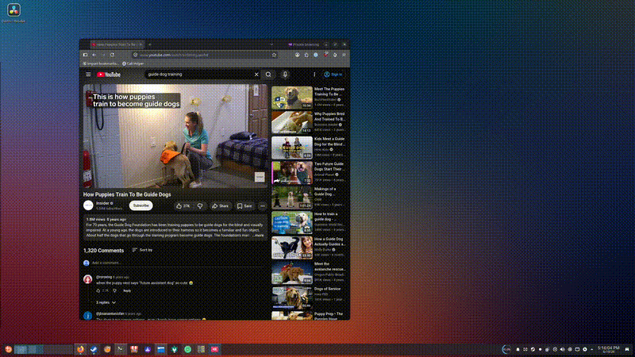

# Just Right

[](https://ko-fi.com/vastworks)



A Sizer-style window resizer for **KDE Plasma on Wayland**, with **beta support
for X11 desktops** like Linux Mint / Cinnamon. (Project folder is `window-sizer/`;
the user-facing name is "Just Right".) Resize the active window to exact dimensions
from a system-tray menu or a keyboard shortcut.

On Wayland, ordinary apps can't move or resize other apps' windows; only the
compositor can. So on KDE the actual resizing is done by a tiny **KWin script**,
and a **PyQt6 tray app** drives it over DBus. On X11 the same tray drives a
`wmctrl`-based backend directly. The tray auto-detects your desktop and picks
the right backend at launch.

> **See [CHANGELOG.md](CHANGELOG.md) for what's new in each release.**

## What it does

- **Tray menu of preset sizes.** Click a preset → the currently active window
  snaps to that size. Each preset can optionally re-center the window on its
  current monitor.
- **Keyboard shortcuts (optional).** Every preset is also a KDE global action.
  Open *System Settings → Shortcuts*, search **"Window Sizer"**, and bind keys.
- **Aspect-ratio scaler.** A "Resize to ratio" menu offers a ladder of sizes per
  ratio (16:9, 4:3, ...), scaled to fit the active window's usable display area.
  Each ratio has a **Fit work area** action for the largest fitting rectangle.
  Use **Custom ratio…** to add arbitrary ratios such as 32:9, 5:4, 1:1, or 9:16.
  Hold Alt to flip them to
  portrait (9:16, ...) for a pivoted monitor.
- **Super + scroll to resize (X11).** Hold Super and scroll the wheel over a
  window to step it up or down the size ladder for its current ratio, keeping its
  orientation.
- **Editable presets.** Add / edit / delete sizes in a small GUI.
- **Developer-size template.** The editor can add a `Developer sizes` category
  containing 640×360, 854×480, 1280×720, 1600×900, and 1920×1080. They are
  ordinary editable presets, so client-area mode can be selected where needed.
- **Size popup.** A size indicator appears whenever a window is resized. On KDE
  this uses the Plasma OSD; on X11 it is a floating, outlined readout that
  follows the cursor while you drag.
- **Runs on KDE and X11.** One tray app; it auto-detects the desktop and uses
  the KWin backend on Plasma or the `wmctrl` backend on X11 (Mint / Cinnamon,
  beta).

## Install

```bash
cd window-sizer
bash install.sh
```

The installer:
- installs PyQt6 for the current user if it isn't already available,
- writes default presets and loads the KWin script,
- adds an autostart entry (tray starts at login) and a menu launcher for the editor.

Start the tray immediately, without logging out:

```bash
setsid python3 sizer_tray.py >/dev/null 2>&1 &
```

Run the display-free unit tests with:

```bash
python3 -m unittest discover -s tests
```

### X11 desktops (Mint / Cinnamon, beta)

On X11 the resizing is done with `wmctrl`, and the live size popup uses
`python3-xlib`. Install those plus PyQt6:

```bash
sudo apt install wmctrl xdotool python3-xlib python3-pyqt6
python3 sizer_tray.py
```

The tray detects X11 automatically and uses the `wmctrl` backend. Presets,
centering, the "Add current window size" capture, and the live drag popup all
work. See **Notes / limits** for what is KDE-only.

## Files

| File | Purpose |
|------|---------|
| `sizer_engine.py` | Shared presets file plus the KDE/KWin backend: generates the KWin script, loads it, triggers presets over DBus |
| `sizer_backend.py` | Picks a backend at launch (KWin on Plasma, `wmctrl` on X11) behind one interface |
| `sizer_overlay_x11.py` | X11-only live drag-dimensions popup (event-driven via python-xlib) |
| `sizer_tray.py` | System-tray app: the menu of presets |
| `sizer_editor.py` | PyQt6 dialog to add/edit/delete presets (also runs standalone) |
| `install.sh` | One-shot setup: deps, autostart, launcher |

## Config

- Presets: `~/.config/window-sizer/presets.json`
- Remembered per-application presets: `~/.config/window-sizer/app-presets.json`
- Custom ratios: `~/.config/window-sizer/custom-ratios.json`
- Generated KWin script: `~/.config/window-sizer/window-sizer.js`

Each preset is `{ "name", "width", "height", "position", "identifier", "category", "sizeMode" }`, where
`position` is `"keep"` or `"center"`. The `identifier` is stable across renames
so any keyboard shortcut you assign stays bound. `category` is optional; presets
in the same category appear together in a submenu, while existing presets with no
category keep their flat menu position. `sizeMode` is `"outer"` (the default) or
`"client"`. Client mode is a KWin-only one-shot conversion using KWin's
`clientGeometry`; it is not a promise of an application's semantic game/web
viewport and falls back to outer sizing on X11.

The preset model derives `aspectRatio` from its width and height (for example,
`1280×720` becomes `[16, 9]`) when generating KWin menu/action data. This avoids
duplicating ratio metadata that could drift when a preset is edited; `category`
remains the user-controlled menu grouping.

When you select a saved preset, Just Right remembers it for that application and
offers it as **Last used** in the tray menu next time. It never automatically
resizes a newly opened window. On Plasma it identifies apps by desktop file name
where available, then falls back to window class/name; X11 uses the window class.

## How it works

1. `sizer_engine.generate_script()` bakes the preset list into a KWin JavaScript
   file. For each preset it calls `registerShortcut()`, creating a named action
   that sets the active window's `frameGeometry`.
2. `reload_kwin_script()` loads that file into KWin via
   `org.kde.KWin /Scripting loadScript`.
3. The tray triggers a preset by calling
   `org.kde.kglobalaccel … invokeShortcut <action>`. The same action is what a
   keyboard shortcut would fire.

The **Fit 16:9**, **Fit 16:10**, **Fit 4:3**, **Fit 3:2**, and **Fit 21:9**
actions are also exposed in KDE's standard shortcut configuration, without
default bindings. They are available from the title-bar menu as well.

Sizes apply to the **window frame** (title bar + borders included), matching the
original Windows Sizer. Centering uses the available area of the window's current
monitor, so it works correctly across multiple displays.

On Plasma, Just Right displays the active output scale in its tray menu. Preset
dimensions are always **logical KWin pixels**. In particular, `1920×1080` at
150% scale is a logical geometry request, not a guaranteed `1920×1080` capture
buffer or application viewport.

## Notes / limits

- A window that declares itself non-resizable is left alone.
- Ratio-menu entries are exact logical frame targets. A client may still apply
  minimum/maximum or size-increment hints (terminal cell grids are a common
  example), so their final frame can be only a best-effort match. The KWin
  backend makes at most one bounded follow-up correction; it never runs a
  persistent geometry-change loop.
- If you change presets, the tray reloads automatically. If you edit
  `presets.json` by hand, pick **Reload backend** from the tray menu.

### X11 backend (beta)

- **No built-in global shortcuts.** KDE registers each preset as a global
  action; on X11 there is no equivalent yet. Bind a `wmctrl` command to a key in
  *Cinnamon Settings, Keyboard, Shortcuts* if you want hotkeys.
- **Live popup needs `python3-xlib`.** Without it the tray still works, just
  with no drag readout.
- **Reparenting window managers.** The live popup keys off the active window,
  which assumes client-side decorations (true on Cinnamon). On window managers
  with server-side frames the drag readout may not appear; presets still work.
- The KWin/Wayland backend exists because on Wayland `wmctrl`/`xdotool` cannot
  see or move native windows; only the compositor can.
